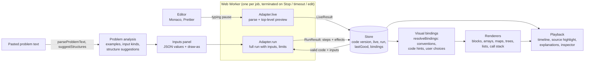

# Architecture: from pasted problem and code to a drawing

## Contracts

| Contract          | Where                   | What it promises                                                                                                                                                                                                                                                                 |
| ----------------- | ----------------------- | -------------------------------------------------------------------------------------------------------------------------------------------------------------------------------------------------------------------------------------------------------------------------------- |
| `LanguageAdapter` | `src/engine/adapter.ts` | `live(code) → LiveResult` (never runs function bodies) and `run(request) → RunResult`. One adapter per language; only JavaScript exists.                                                                                                                                         |
| Trace             | `src/trace/types.ts`    | `Step` = immutable snapshot: source location, call frames with variables, heap (objects by stable id), the step's `Effect`s, output count.                                                                                                                                       |
| Events (`Effect`) | `src/trace/types.ts`    | `create` (object/node), `declare`/`assign` (variable), `prop-write`/`prop-read` (field change/read), `index-write`/`index-read`, `array-add`/`array-remove`/`array-change`, `map-*`/`set-*`, `call`/`return`, `compare`, `log`. Errors are `EngineError` with kind and location. |
| Values            | `ValueSnap`, `HeapSnap` | Primitives inline; objects as `{t:'ref', id}` into the heap, so aliases share an id, `null` is explicit and cycles are just refs.                                                                                                                                                |
| Visual bindings   | `src/viz/bindings.ts`   | `NodeShape` (tree: value/left/right fields, list: value/next) per class, array role (cells/stack/queue) and index pointers per variable. Each binding records its source: convention, code, or the user. Ambiguous classes are reported, not guessed.                            |
| Renderers         | `src/viz/*`             | Read only `Step` + bindings (`shapeOf`, effective hints). They never read source code.                                                                                                                                                                                           |

`root = TreeNode(5); root.left = TreeNode(3)` records: `create A (TreeNode)`, `declare root → A`, `create B`, `prop-write A.left: null → B` (tested in `bindings.test.ts`).

## Live editing

1. Typing pause (300 ms) → `Adapter.live` in the Live worker. The result is tagged with the code it came from.
2. Unfinished, unsupported or failing code → no new drawing; the previous valid one stays, labeled.
3. If the code parses and is supported and "Run as I type" is on → `startRun({auto})` in the Run worker with the selected inputs. Each run gets a token; only the newest may publish. Editing cancels an in-flight run (worker terminated).
4. A finished run replaces the drawing (wrong answers included, compared with the expected output). A failed run shows its error and line; the last successful run stays, labeled.

## AI's place (not built)

Optional and never in the data path: it could suggest bindings (as user-confirmable choices) or explain recorded events. It must not create values, connections, steps or results. Everything above works without it.

## Staged plan

1. **Done**: JavaScript adapter, trace contract, Live Build, auto-run with cancellation, bindings with editing UI, renderers for blocks, arrays, maps, sets, trees, linked lists, call stack.
2. **Next**: a second adapter to validate the contract. Python via Pyodide (CPython in WebAssembly, traced with `sys.settrace`) is the candidate; TypeScript via position-preserving type erasure would reuse the JavaScript runtime and so would not test the contract as well.
3. Graph, heap, DP-dependency and backtracking renderers on the same bindings (graph adjacency → `graph` role, heap array → tree + array view).
4. Java and C++ adapters behind a server-side sandbox with CPU, memory, time and output quotas and no network.
